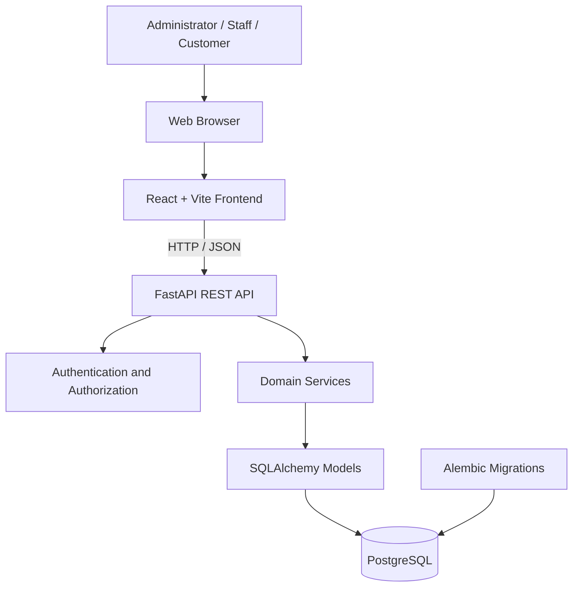
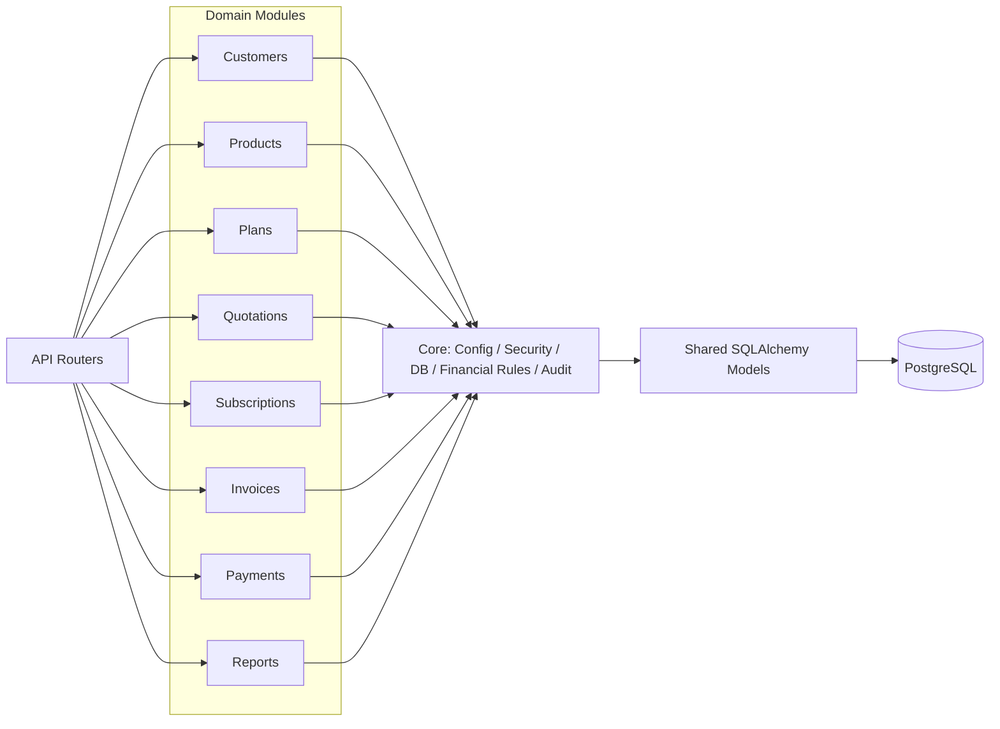
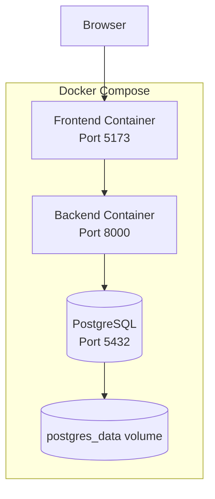
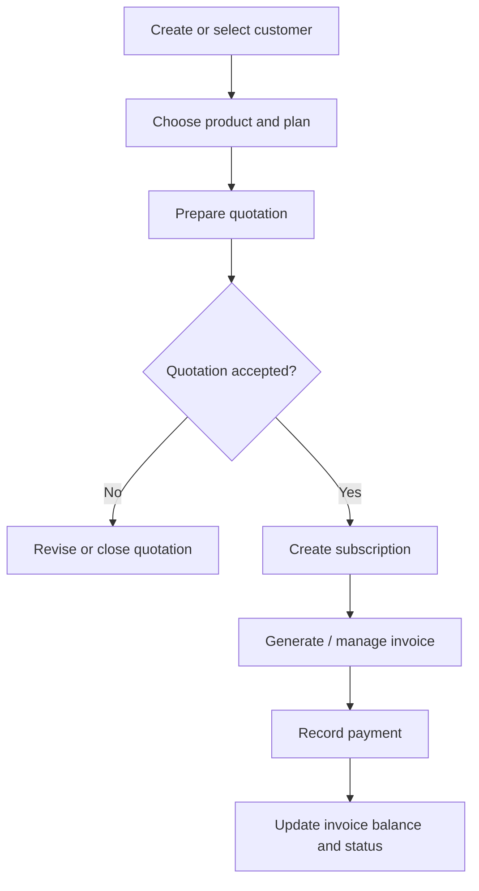

# Subscription Management System

A full-stack application for managing customers, products, subscription plans, quotations, recurring subscriptions, invoices, and payment records. The project is organized as a **modular monolith**: a React frontend communicates with a FastAPI REST backend, while PostgreSQL stores application data.

> **Project status:** The repository contains the backend, frontend, database migrations/seeds, Docker Compose configuration, tests, and project documentation. The setup instructions below describe the committed configuration; run the application and test suite in your environment before treating it as production-ready.

## Contents

- [Overview](#overview)
- [Features and Modules](#features-and-modules)
- [Architecture](#architecture)
- [Technology Stack](#technology-stack)
- [Repository Structure](#repository-structure)
- [Prerequisites](#prerequisites)
- [Run with Docker Compose](#run-with-docker-compose)
- [Run Locally](#run-locally)
- [Database and Migrations](#database-and-migrations)
- [Testing](#testing)
- [Configuration and Security](#configuration-and-security)
- [Documentation](#documentation)
- [Roadmap](#roadmap)

## Overview

The Subscription Management System centralizes the main operational workflows involved in recurring services:

1. Maintain customer and product records.
2. Configure plans and commercial terms.
3. Prepare quotations for customers.
4. Create and manage subscriptions.
5. Track invoices and payment records.
6. Review operational and financial information.

The application uses a versioned API boundary and separates domain responsibilities into backend modules. This keeps the codebase easier to understand and extend without introducing the operational overhead of multiple independently deployed services.

## Features and Modules

| Module | Responsibility |
|---|---|
| Authentication | Login and authenticated user context |
| Customers | Customer profile and account management |
| Products | Product catalogue and product variants |
| Plans | Subscription plan and pricing configuration |
| Quotations | Quotations and line-item workflows |
| Subscriptions | Subscription records and lifecycle management |
| Invoices | Invoice records, totals, and due/payment status |
| Payments | Payment records and invoice settlement tracking |
| Discounts | Discount-related frontend workflows and supporting domain data |
| Reports | Operational and financial summaries |
| Customer Portal | Customer-facing subscription and invoice views |

Availability of individual actions depends on the current backend routes and permissions. Payment-provider processing, email delivery, and production billing automation should be treated as integrations requiring configuration and end-to-end validation.

## Architecture

### High-level architecture

The browser loads the React application. The frontend calls the FastAPI backend through HTTP. The backend applies authentication, validation, and domain logic, then reads or writes application data in PostgreSQL.



### Backend modular architecture



### Deployment architecture

The included `docker-compose.yml` defines three services: frontend, backend, and PostgreSQL. PostgreSQL uses a named volume for persistent data.



### Main business workflow



## Technology Stack

| Layer | Technologies |
|---|---|
| Frontend | React 18, Vite, React Router, Tailwind CSS, Recharts, Axios |
| Backend | Python, FastAPI, Pydantic, Uvicorn |
| ORM and migrations | SQLAlchemy, Alembic |
| Database | PostgreSQL |
| Testing | Pytest, HTTPX |
| Deployment | Docker, Docker Compose |

## Repository Structure

```text
subscription-management-system/
├── backend/
│   ├── app/
│   │   ├── auth/
│   │   ├── core/
│   │   ├── customers/
│   │   ├── invoices/
│   │   ├── models/
│   │   ├── payments/
│   │   ├── plans/
│   │   ├── products/
│   │   ├── reports/
│   │   ├── schemas/
│   │   └── subscriptions/
│   ├── Dockerfile
│   └── requirements.txt
├── database/
│   ├── diagrams/
│   ├── migrations/
│   └── seeds/
├── docs/
│   ├── api/
│   ├── architecture/
│   ├── submission/
│   └── workflows/
├── frontend/
│   ├── src/
│   │   ├── components/
│   │   ├── pages/
│   │   └── services/
│   ├── Dockerfile
│   └── package.json
├── tests/
│   ├── api/
│   ├── integration/
│   ├── security/
│   └── unit/
├── docker-compose.yml
├── pytest.ini
└── README.md
```

## Prerequisites

For Docker-based setup:

- Docker Desktop on Windows/macOS, or Docker Engine on Linux
- Docker Compose v2
- Git

For manual local setup:

- Python 3.11 or newer (Python 3.12 is suitable)
- Node.js 18 or newer and npm
- PostgreSQL 15 or newer

## Run with Docker Compose

Run these commands from the repository root:

```bash
# Clone the repository
git clone https://github.com/jwalapratapsingh1212-sketch/subscription-management-system.git
cd subscription-management-system

# Start frontend, backend, and database
docker compose up --build
```

When the containers finish building and start successfully, open:

| Service | Local URL |
|---|---|
| Frontend | http://localhost:5173 |
| Backend API | http://localhost:8000 |
| FastAPI Swagger UI | http://localhost:8000/docs |
| PostgreSQL | localhost:5432 |

Useful Docker commands:

```bash
# Run in the background
docker compose up --build -d

# View service status
docker compose ps

# Follow logs
docker compose logs -f

# Stop services (keeps the named database volume)
docker compose down

# Stop services and delete the database volume (DELETES local database data)
docker compose down -v
```

**Important database note:** The Compose file mounts the two SQL migration scripts into PostgreSQL's `/docker-entrypoint-initdb.d` directory. PostgreSQL runs these initialization scripts when the data directory is first initialized. If the named volume already contains a database, those scripts are not automatically re-run. Review the SQL scripts and use the project's migration workflow when updating an existing database.

## Run Locally

### 1. Backend

From the repository root:

```bash
# Create and activate a virtual environment
python -m venv .venv

# Windows PowerShell
.venv\Scripts\Activate.ps1

# macOS / Linux
source .venv/bin/activate

# Install backend dependencies
pip install -r backend/requirements.txt
```

Configure the environment variables required by the backend, including the database connection string and authentication secret. Start PostgreSQL and ensure the database schema has been initialized.

Start the API (assuming the application entry point is `app.main:app`):

```bash
# Windows PowerShell
$env:PYTHONPATH = "backend"
uvicorn app.main:app --reload --app-dir backend

# macOS / Linux
PYTHONPATH=backend uvicorn app.main:app --reload --app-dir backend
```

API documentation: http://localhost:8000/docs

### 2. Frontend

Open a second terminal:

```bash
cd frontend
npm install
npm run dev
```

Vite will print the local development URL in the terminal (the default is usually http://localhost:5173). Configure the frontend API base URL to point to the running backend if your local environment differs from the Docker Compose configuration.

## Database and Migrations

Database assets are organized under `database/`:

- `migrations/001_initial_schema.sql` — initial SQL schema.
- `migrations/002_rls_policies.sql` — row-level security policy definitions.
- `migrations/env.py`, `alembic.ini`, and `versions/` — Alembic migration configuration and version scripts.
- `seeds/seed_data.py` — seed data utility.
- `diagrams/` — entity relationship and lifecycle diagrams.

Review the migration files and configure the database URL before applying migrations. Do not assume SQL initialization scripts and Alembic migrations are interchangeable; use one controlled schema-management process for each environment.

## Testing

The repository includes test suites for API, integration, security, and unit-level behavior.

From the repository root, after installing backend dependencies and configuring a test database/environment:

```bash
pytest
```

Run a focused suite:

```bash
pytest tests/unit
pytest tests/api
pytest tests/integration
pytest tests/security
```

Test execution results depend on the configured database, environment variables, and current implementation. No passing CI or test status is implied by the presence of these test files.

## Configuration and Security

The repository includes a root `.env.example` file. Review it and create a local environment file as appropriate for your setup. Never commit real credentials.

At minimum, review these settings before deployment:

- PostgreSQL username, password, database name, and port.
- Backend database connection URL.
- JWT/signing secret.
- CORS allowed origins.
- Frontend API base URL.

The values in the Compose file are development defaults, **not production secrets**. Replace them before exposing the application to a network. Use HTTPS, restrict CORS to trusted origins, apply least-privilege database credentials, and store secrets in a secure environment or secret manager.

## Documentation

- [System Architecture](docs/architecture/system_architecture.md)
- [API Reference](docs/api/api_reference.md)
- [Business Workflows](docs/workflows/business_workflows.md)
- [Database Diagrams](database/diagrams/er_and_lifecycle_diagrams.md)
- [Hackathon Submission Checklist](docs/submission/hackathon_submission_checklist.md)

## Roadmap

- [ ] Validate complete Docker Compose startup on a clean machine.
- [ ] Run and document the full backend test suite.
- [ ] Validate database initialization and Alembic upgrade flow.
- [ ] Complete end-to-end tests for quotation-to-subscription-to-invoice workflows.
- [ ] Verify tenant isolation and role-based access across all endpoints.
- [ ] Configure production secrets, HTTPS, backups, logging, and monitoring.
- [ ] Integrate and test external payment and email providers where required.

## Contributing

1. Create a feature branch.
2. Keep changes scoped to the relevant frontend, backend, database, or documentation module.
3. Add or update tests for behavior changes.
4. Run the relevant test suite and frontend build.
5. Open a pull request with a clear description and verification notes.

## License

No license file is currently specified in this repository. All rights are reserved unless a license is added by the repository owner.
