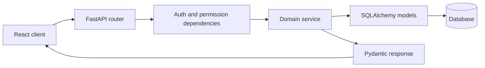

# Backend Application Package

This package contains the FastAPI application and the domain modules mounted by the application entrypoint.

## Application startup

`main.py` creates the FastAPI instance, configures CORS middleware, registers domain routers, and exposes health endpoints. Its lifespan handler creates database tables and, unless disabled with `SKIP_AUTO_SEED=true`, invokes the demo-data seeder.

The versioned API prefix is configured through `API_V1_PREFIX` (default: `/api/v1`). Routers are also mounted at the root path for compatibility; the root-mounted routes are hidden from the generated OpenAPI schema.

## Package map

| Package | Responsibility |
|---|---|
| `auth/` | Login, registration, token refresh, password reset, staff administration |
| `core/` | Settings, SQLAlchemy engine/session, security, permissions, audit, seeding |
| `customers/` | Customer records and customer profile operations |
| `products/` | Products and variants |
| `plans/` | Subscription plan catalogue |
| `subscriptions/` | Quotations and subscription lifecycle |
| `invoices/` | Invoices, discounts, and tax rules |
| `payments/` | Payment records and invoice balances |
| `reports/` | Dashboard, finance, and customer portal reporting |
| `models/` | SQLAlchemy model registration |

## Request path

## Development conventions

- Keep endpoint functions focused on HTTP concerns.
- Put domain rules and multi-step operations in service functions.
- Validate payloads with Pydantic schemas.
- Use the shared database dependency for request-scoped sessions.
- Record important state changes through the audit utility.
- Add tests for authorization boundaries and monetary edge cases.

For setup and run commands, see [backend/README.md](../README.md). For the architecture overview, see [system architecture](../../docs/architecture/system_architecture.md).

## Important implementation caveats

Startup currently calls `Base.metadata.create_all`; this is not a replacement for a production migration workflow. CORS is configured broadly in `main.py` and must be restricted before deployment. Review configuration and security settings before exposing this service publicly.
