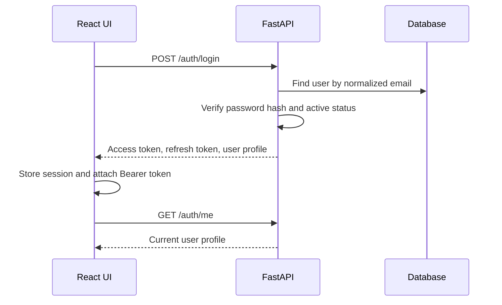

# Authentication and Role-Based Access

This module handles account registration, login, token issuance, session revocation, password recovery, and administrator-managed staff accounts.

## HTTP endpoints

All endpoints are registered under `/api/v1/auth` (the application also mounts compatibility routes without the version prefix).

| Method | Path | Purpose | Access |
|---|---|---|---|
| POST | `/register` | Create a customer account and linked customer profile | Public |
| POST | `/login` | Verify credentials and issue access/refresh tokens | Public |
| POST | `/logout` | Revoke the current access token | Authenticated |
| POST | `/refresh` | Exchange a refresh token for a new token pair | Refresh token |
| POST | `/forgot-password` | Generate a password-reset token | Public |
| POST | `/reset-password` | Set a new password using a reset token | Reset token |
| GET | `/me` | Return the current user's profile | Authenticated |
| POST | `/staff` | Create an internal staff/admin account | Admin |
| GET | `/users` | List user accounts | Admin |
| PATCH | `/users/{user_id}` | Update user status, name, or role | Admin |

## Authentication flow

Customer self-registration creates a user with the customer role and links an existing unclaimed customer record with the same email when available; otherwise it creates a customer profile. Staff creation and user administration are protected by the admin dependency.

## Frontend integration

The frontend API wrapper is [client.js](../../../frontend/src/services/api/client.js). Session state and login/register/logout behavior are managed by [AuthContext.jsx](../../../frontend/src/services/auth/AuthContext.jsx).

## Security considerations

- Passwords are hashed before persistence and checked through the shared security utilities.
- Access and refresh tokens have separate token types.
- Logout revokes the presented access token.
- Admin-only operations use a server-side authorization dependency.
- Do not place real credentials or tokens in source control.

**Demo limitation:** The current forgot-password endpoint returns the reset token in its response and the UI displays it for the demo flow. A production implementation should deliver a short-lived, single-use token through a verified out-of-band channel (for example, email), avoid exposing it in API responses, apply rate limits, and audit reset attempts. Also review token storage and CORS policy before production use.
