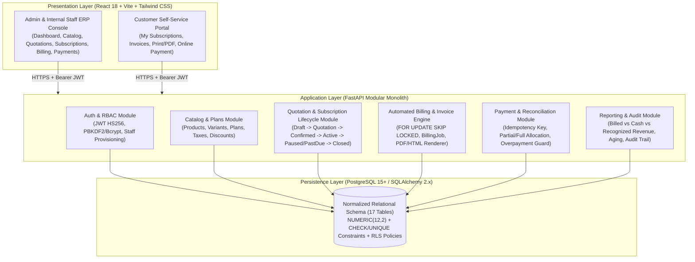

# System Architecture & Enterprise Roadmap

## 1. Executive Architectural Overview

The **Subscription Management System** is an enterprise-grade recurring billing, order-to-cash, and subscription lifecycle management platform implemented as a **Modular Monolith**. It translates the specifications from both `Subscription System Development Guide.pdf` and `Subscription_Management_System_Final_Architecture_Guide.pdf` into a cohesive, transactionally safe, and extensible system.

### Key Architectural Principles
1. **Modular Monolith with Explicit Domain Boundaries**: Each business capability (`auth`, `customers`, `products`, `plans`, `subscriptions`, `invoices`, `payments`, `reports`) resides in an isolated module with its own Pydantic schemas, business service layer, and FastAPI router while sharing a single ACID database transaction boundary.
2. **Backend-Enforced Financial Integrity**: All monetary values use fixed-point `NUMERIC(12, 2)` in PostgreSQL and `Decimal` with `ROUND_HALF_UP` in Python (`backend/app/core/financials.py`). The frontend never performs authoritative financial arithmetic.
3. **Immutable Historical Snapshots**: When a subscription generates an invoice, the invoice lines snapshot the exact product description, unit price, discount, and tax rate active at billing time. Later price edits on products or variants never mutate historical invoices.
4. **Idempotent Financial Operations**:
   - **Invoices**: Guarded by both a database unique constraint `uq_invoice_subscription_billing_period` on `(subscription_id, billing_period_start, billing_period_end)` and application-level pre-checks.
   - **Payments**: Guarded by a unique `idempotency_key` on `payments` and strict balance reconciliation inside an ACID transaction.
5. **Defense-in-Depth Authorization & Tenant Isolation**:
   - Every endpoint enforces role-based access control (`admin`, `internal_staff`, `customer`).
   - Customer portal users are strictly isolated to their linked `customer_id` at the service query layer (`enforce_customer_ownership`) and backed by PostgreSQL Row-Level Security (`database/migrations/002_rls_policies.sql`).

---

## 2. System Context & Component Diagram

---

## 3. Domain Module Breakdown

| Module | Path | Responsibilities |
| :--- | :--- | :--- |
| **Core Infrastructure** | `backend/app/core/` | Configuration (`config.py`), SQLAlchemy engine & session management (`database.py`), JWT & password hashing (`security.py`), RBAC & customer ownership checks (`permissions.py`), `Decimal` financial engine (`financials.py`), and immutable audit logging (`audit.py`). |
| **Authentication (`auth`)** | `backend/app/auth/` | Customer self-registration, unique email validation, password complexity enforcement, login/logout, password reset token issuance & consumption, and Admin-only staff creation. |
| **Customers (`customers`)** | `backend/app/customers/` | Customer profile CRUD, billing address & tax ID management, portal user linking, and customer-scoped subscription/invoice summaries. |
| **Products (`products`)** | `backend/app/products/` | Product catalog (`saas`, `service`, `consumable`, `hardware`), sales/cost prices, variants with `additional_price` deltas, and activation/deactivation lifecycle. |
| **Plans (`plans`)** | `backend/app/plans/` | Recurring billing intervals (`daily`, `weekly`, `monthly`, `yearly`), minimum quantity constraints, availability date windows, and lifecycle flags (`auto_close_days`, `early_close`, `pausable`, `renewable`). |
| **Subscriptions (`subscriptions`)** | `backend/app/subscriptions/` | Reusable quotation templates, quotation lifecycle (`draft` → `sent` → `confirmed` → `converted`), atomic conversion of quotations to subscriptions, and the full subscription state machine (`draft` → `quotation` → `confirmed` → `active` ⇄ `paused` / `past_due` → `closed`, plus `renew`). |
| **Invoices (`invoices`)** | `backend/app/invoices/` | Draft/Confirmed/Paid/Cancelled invoice lifecycle, automated recurring billing batch runner (`BillingJob` + `FOR UPDATE SKIP LOCKED`), tax rules, discount eligibility & usage tracking, and printable HTML/PDF invoice generation. |
| **Payments (`payments`)** | `backend/app/payments/` | Idempotent payment capture, partial and full payment reconciliation, overpayment prevention, invoice balance computation, and overdue sweep. |
| **Reports (`reports`)** | `backend/app/reports/` | Finance dashboard KPIs (MRR, ARR, Billed Revenue, Cash Collected, Recognized Pro-Rata Revenue, Deferred Revenue), overdue aging buckets (`1_30_days`, `31_60_days`, `61_90_days`, `90_plus_days`), monthly trend series, and audit log inspection. |

---

## 4. Key Architecture Decisions (Resolved Ambiguities)

Per Section 12 of `Subscription_Management_System_Final_Architecture_Guide.pdf`, the following architectural ambiguities from the baseline specification were explicitly resolved and unified across the codebase:

### 4.1 Unified Subscription State Machine
- **States**: `draft`, `quotation`, `confirmed`, `active`, `paused`, `past_due`, `closed`.
- **Transitions**:
  - `draft` → `quotation`, `confirmed`, `closed`
  - `quotation` → `confirmed`, `closed`
  - `confirmed` → `active`, `closed`
  - `active` → `paused`, `past_due`, `closed`
  - `paused` → `active`, `closed`
  - `past_due` → `active`, `closed`
  - `closed` → *(terminal state; renewals create/advance via explicit `renew` action when `plan.is_renewable` is enabled)*

### 4.2 Dual Invoice Lifecycle (`state` + `payment_status`)
To reconcile the baseline PDF's four core invoice states with partial-payment and overdue tracking:
- **`Invoice.state`**: `draft` | `confirmed` | `paid` | `cancelled`
- **`Invoice.payment_status`**: `unpaid` | `partially_paid` | `paid` | `overdue` | `cancelled`
- Confirming a draft invoice sets `state = 'confirmed'` and `payment_status = 'unpaid'` (or `'overdue'` if `due_date < today`).
- Recording a partial payment keeps `state = 'confirmed'` and transitions `payment_status = 'partially_paid'`, updating `amount_paid` and `balance_due`.
- Paying the remaining balance sets `state = 'paid'`, `payment_status = 'paid'`, `balance_due = 0.00`, and automatically restores a `past_due` subscription to `active`.

### 4.3 Revenue Metric Disambiguation
The Finance Dashboard (`GET /api/v1/reports/dashboard`) explicitly separates four distinct accounting metrics so operators never conflate invoiced totals with cash or earned revenue:
1. **`billed_revenue`** (`billed_net_ex_tax` + `billed_tax`): Total value of confirmed and paid invoices issued within the period.
2. **`cash_collected`**: Actual completed payment transactions (`Payment.status = 'completed'`) received within the period.
3. **`recognized_revenue_pro_rata`**: Earned revenue calculated pro-rata across each invoice's `[billing_period_start, billing_period_end]` service window.
4. **`deferred_revenue_unearned`**: Invoiced net revenue for future service days not yet delivered (`max(0, billed_net - recognized_pro_rata)`).

---

## 5. Advanced Enterprise Features: Implemented MVP vs. Future Phases

| Enterprise Capability | Status in Codebase | Implementation & Location |
| :--- | :--- | :--- |
| **Multi-Tenancy & PostgreSQL RLS** | **Implemented** | Service-layer `enforce_customer_ownership` in `backend/app/core/permissions.py` + PostgreSQL Row-Level Security policies in `database/migrations/002_rls_policies.sql` using `app.current_user_role` and `app.current_customer_id`. |
| **Concurrent Billing Workers (`SKIP LOCKED`)** | **Implemented** | `run_recurring_billing` in `backend/app/invoices/service.py` uses `.with_for_update(skip_locked=True)` on due `Subscription` rows and records execution metrics in `billing_jobs`. |
| **Invoice Idempotency** | **Implemented** | Unique constraint `uq_invoice_subscription_billing_period` on `invoices(subscription_id, billing_period_start, billing_period_end)` + pre-check in `run_recurring_billing`. |
| **Payment Idempotency** | **Implemented** | Unique `idempotency_key` column on `payments` table; duplicate keys return the existing `Payment` record without double-charging or double-decrementing `balance_due`. |
| **Historical Price & Tax Snapshots** | **Implemented** | `InvoiceLine` persists `unit_price`, `discount_amount`, `tax_rate`, `tax_amount`, and `subtotal` at generation time. |
| **Immutable Audit Trail** | **Implemented** | `AuditLog` model (`audit_logs` table) records actor, role, action, entity type/ID, and old/new JSON snapshots across state transitions and financial mutations. |
| **ASC 606 / IFRS 15 Pro-Rata Recognition** | **Implemented (Core)** | Daily pro-rata earned vs. deferred revenue calculation across service periods (`billing_period_start` to `billing_period_end`) in `backend/app/reports/service.py`. Full multi-element performance obligation allocation is documented for Phase 2. |
| **External Payment Gateway Webhooks** | **Phase 2 Roadmap** | Architecture supports asynchronous webhook ingestion via `Payment.idempotency_key` and `external_reference`. Live Stripe/Razorpay HMAC signature verification and dead-letter queues are planned for Phase 2. |
| **Mid-Cycle Proration Credit Notes** | **Phase 2 Roadmap** | Currently, quantity/plan modifications apply cleanly on confirm/renewal or next billing period. Automated mid-cycle credit-memo generation and daily delta proration lines are scheduled for Phase 2. |
| **Plan Phases, Trials & Usage Entitlements** | **Phase 2 Roadmap** | Trial period state transitions and metered usage entitlement counters (`feature_limits` JSONB + Redis rate counters) are designed as Phase 2 extensions. |
| **Materialized Views & OLAP Warehouse** | **Phase 2 Roadmap** | Current reporting queries indexed relational tables directly (`< 50ms` for thousands of rows). High-volume deployments can attach `REFRESH MATERIALIZED VIEW CONCURRENTLY` for monthly cohort cubes. |

