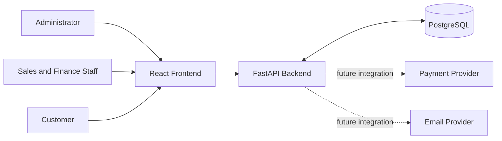
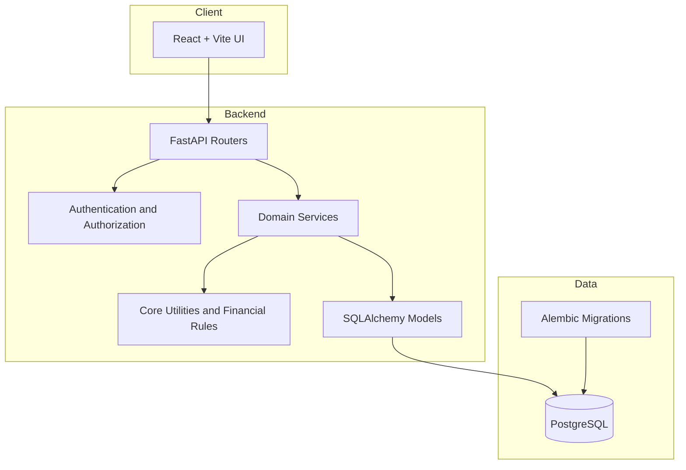
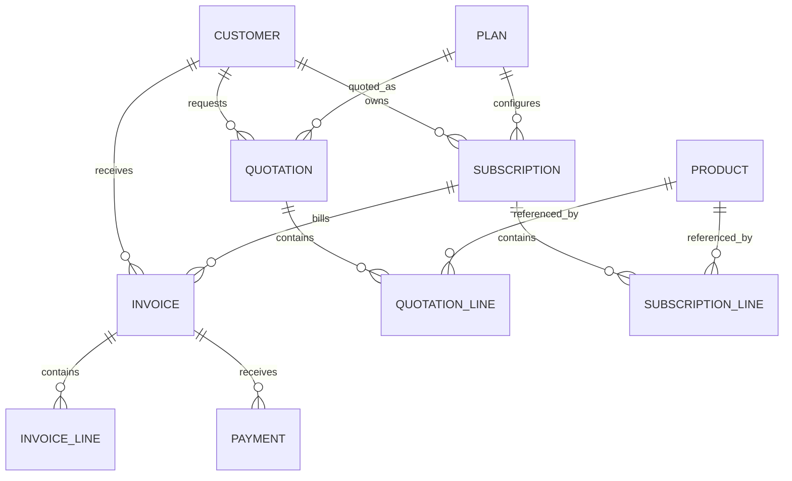
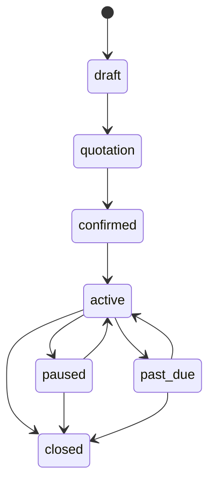
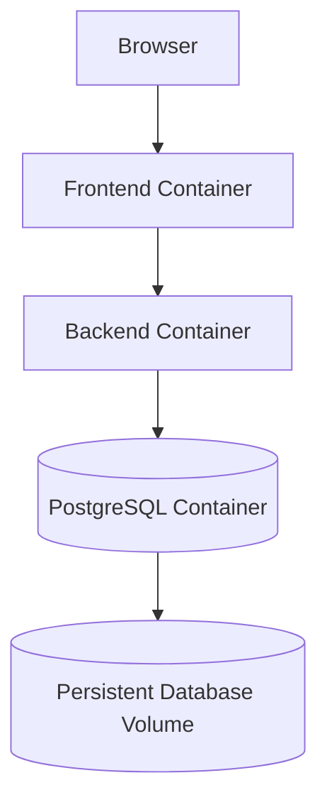

# System Architecture & Enterprise Roadmap

## 1. Executive Architectural Overview

The **Subscription Management System** is an enterprise-grade recurring billing, order-to-cash, and subscription lifecycle management platform implemented as a **Modular Monolith**. It translates the specifications from both `Subscription System Development Guide.pdf` and `Subscription_Management_System_Final_Architecture_Guide.pdf` into a cohesive, transactionally safe, and extensible system.

### Key Architectural Decisions

- **Modular Monolith:** Domain modules are separated by responsibility while sharing one deployable backend and database.
- **API-first:** FastAPI exposes versioned REST endpoints for the frontend and integrations.
- **Relational persistence:** SQLAlchemy models and Alembic migrations manage PostgreSQL schema evolution.
- **Tenant-aware access:** Organization-scoped data access and role-based permissions protect customer and billing records.
- **Financial correctness:** Decimal-based monetary calculations, explicit invoice/payment states, idempotency keys, and audit events protect billing workflows.
- **Operational readiness:** Docker-based local deployment, health checks, structured configuration, automated tests, and API documentation support maintainability.

## 2. System Context

The system supports administrators, sales and finance operators, and customers using a self-service portal.

### External actors

| Actor | Responsibilities |
|---|---|
| Administrator | Manages users, roles, products, plans, settings, and access |
| Sales operator | Manages customers, quotations, and subscriptions |
| Finance operator | Reviews invoices, records payments, and monitors receivables |
| Customer | Views subscriptions, invoices, and payment history through the portal |
| External payment provider | Potential integration for payment authorization and settlement |
| Email provider | Potential integration for notifications and invoice delivery |

### High-level context flow

## 3. Logical Architecture

The application is organized into presentation, API, domain-service, persistence, and infrastructure layers.

### Layer responsibilities

1. **Frontend:** Renders dashboards, forms, tables, customer portal screens, and client-side navigation.
2. **API routers:** Validate requests, apply authentication dependencies, invoke services, and return response schemas.
3. **Authentication and authorization:** Verifies credentials and tokens, enforces roles, and scopes access to the appropriate organization.
4. **Domain services:** Implements customer, product, plan, quotation, subscription, invoice, payment, and reporting use cases.
5. **Core utilities:** Centralizes configuration, database sessions, security helpers, financial calculations, audit logging, and seed utilities.
6. **Persistence models:** Defines relational entities, constraints, indexes, and relationships.
7. **Database and migrations:** Stores transactional state and applies version-controlled schema changes.

## 4. Backend Domain Modules

| Module | Main responsibilities |
|---|---|
| Auth | Login, token issuance, current-user context, and access control |
| Customers | Customer profiles, contact details, and account status |
| Products | Product catalogue, variants, and tax-related information |
| Plans | Subscription plans, pricing, billing intervals, and features |
| Quotations | Quotation creation, line items, validity, and conversion |
| Subscriptions | Lifecycle transitions, recurring amounts, renewal, pause, and closure |
| Invoices | Invoice generation, due dates, totals, and payment status |
| Payments | Payment recording, idempotency, and invoice balance updates |
| Reports | Operational and financial summaries |

Each module owns its request/response schemas and service logic. Routers should remain thin; business rules belong in services or shared domain utilities.

## 5. Core Data Model

The principal entities include:

- **User and Organization:** Identity, role, and tenant ownership.
- **Customer:** Customer account and contact information.
- **Product and ProductVariant:** Sellable items and optional variants.
- **Plan:** Recurring subscription pricing and billing configuration.
- **TaxRule and Discount:** Tax treatment and discount configuration.
- **Quotation and QuotationLine:** Commercial offer and itemized pricing.
- **Subscription and SubscriptionLine:** Contracted recurring service and line items.
- **Invoice and InvoiceLine:** Billing document and immutable billing snapshot.
- **Payment:** Recorded settlement against an invoice.
- **AuditLog:** Traceable record of important business actions.
- **BillingJob:** Scheduled work for recurring invoice generation.

### Relationship overview

The database migrations are the authoritative schema definition. The diagram is a conceptual summary and may omit supporting relationships and columns.

## 6. Key Business Workflows

### 6.1 Customer-to-subscription workflow

1. Staff creates or selects a customer.
2. Staff selects a plan and configures products, discounts, and taxes.
3. The system calculates quotation line totals and overall totals.
4. A quotation is issued and may be confirmed.
5. A confirmed quotation can be converted into a subscription.
6. Subscription state and next billing date are maintained according to lifecycle rules.

### 6.2 Recurring billing workflow

1. A billing job becomes due for an active subscription.
2. The worker claims the job and prevents duplicate processing.
3. The system calculates the billing period and invoice amounts.
4. An invoice and its line-item snapshot are persisted transactionally.
5. The billing job is marked completed and linked to the invoice.
6. The customer and finance team can review the invoice.

### 6.3 Payment workflow

1. An authorized user records or receives a payment event.
2. An idempotency key prevents duplicate payment recording.
3. The payment is associated with the relevant invoice and customer.
4. Amount paid and amount due are recalculated.
5. Payment status is updated to unpaid, partially paid, paid, overdue, or cancelled as applicable.
6. An audit record captures the action.

### 6.4 Subscription lifecycle

Only valid state transitions should be accepted by the domain service. The API must not allow arbitrary direct state mutation.

## 7. API Design

- Use a versioned API prefix such as `/api/v1`.
- Use resource-oriented paths and appropriate HTTP methods.
- Validate inputs and outputs with Pydantic schemas.
- Return consistent error responses and meaningful HTTP status codes.
- Apply authentication and authorization dependencies to protected endpoints.
- Paginate collection endpoints and support safe filtering/sorting.
- Publish the OpenAPI schema and maintain a human-readable API reference.

Example resource groups:

| Resource | Example endpoint |
|---|---|
| Authentication | `POST /api/v1/auth/login` |
| Customers | `GET /api/v1/customers` |
| Products | `GET /api/v1/products` |
| Plans | `GET /api/v1/plans` |
| Quotations | `POST /api/v1/quotations` |
| Subscriptions | `GET /api/v1/subscriptions` |
| Invoices | `GET /api/v1/invoices` |
| Payments | `POST /api/v1/payments` |
| Reports | `GET /api/v1/reports/summary` |

These endpoint paths are illustrative; the implemented routers and OpenAPI document determine the actual available routes.

## 8. Security and Data Governance

- Store password hashes, never plaintext passwords.
- Keep signing keys, database credentials, and provider secrets in environment variables or a secret manager.
- Enforce authorization on the server; hiding frontend controls is not access control.
- Scope every tenant-owned query to the authenticated organization.
- Validate and normalize user input.
- Use parameterized ORM queries and avoid constructing SQL from untrusted strings.
- Apply least-privilege database credentials.
- Record sensitive business actions in an audit log.
- Avoid logging passwords, access tokens, payment credentials, or unnecessary personal data.
- Configure CORS with explicit trusted origins in production.
- Use HTTPS and secure cookie/token handling in deployed environments.

## 9. Financial Integrity and Reliability

Financial calculations should use fixed-precision decimal arithmetic rather than binary floating-point values.

Key controls:

- Persist invoice line descriptions, quantities, unit prices, tax rates, and totals as a billing snapshot.
- Recalculate invoice balances within a database transaction.
- Use unique constraints for invoice numbers, payment idempotency keys, and billing-period uniqueness.
- Handle retries without creating duplicate invoices or payments.
- Validate that amounts and quantities are within permitted ranges.
- Keep an audit trail for changes to financial and lifecycle state.
- Define rounding rules consistently and test boundary cases.

## 10. Deployment Architecture

The local deployment uses Docker Compose to coordinate the frontend, backend, and PostgreSQL database.

### Deployment components

| Component | Purpose |
|---|---|
| Frontend container | Builds and serves the React application |
| Backend container | Runs the FastAPI application |
| PostgreSQL container | Stores application data |
| Persistent volume | Preserves database data across container restarts |
| Environment configuration | Supplies credentials, ports, and runtime settings |

Production deployments should additionally use managed secrets, TLS termination, backups, monitoring, log aggregation, and a controlled migration process. Development defaults must not be reused as production credentials.

## 11. Testing Strategy

| Test level | Focus |
|---|---|
| Unit | Financial calculations, lifecycle rules, validators, and service logic |
| API | Request validation, response contracts, authentication, and status codes |
| Integration | Database persistence and multi-module workflows |
| Security | Tenant isolation, role enforcement, and unauthorized access |
| Regression | Previously fixed defects and critical billing scenarios |

Critical test cases include duplicate payment submissions, duplicate billing-job execution, partial payments, overdue invoices, invalid lifecycle transitions, discount/tax rounding, and cross-tenant data access.

## 12. Observability and Operations

A production-ready implementation should provide:

- Liveness and readiness health endpoints.
- Structured logs with request or correlation identifiers.
- Error monitoring and alerting.
- Metrics for API latency, error rate, billing-job backlog, and payment failures.
- Database backup and restore procedures.
- Migration and rollback runbooks.
- Operational dashboards for billing and subscription health.

## 13. Risks and Mitigations

| Risk | Mitigation |
|---|---|
| Duplicate invoice generation | Unique billing-period constraint, job locking, and idempotent processing |
| Incorrect monetary totals | Decimal arithmetic, centralized calculation rules, and regression tests |
| Cross-tenant data leakage | Tenant-scoped services, authorization tests, and database constraints where appropriate |
| Secret exposure | Environment-based configuration and secret management |
| Schema drift | Alembic migrations and deployment checks |
| Unreliable external integrations | Timeouts, retries with backoff, idempotency, and reconciliation |
| Operational data loss | Automated backups and tested restoration procedures |

## 14. Implementation Roadmap

1. **Foundation:** Configuration, database connectivity, migrations, authentication, and authorization.
2. **Core catalogue:** Customers, products, plans, taxes, and discounts.
3. **Commercial workflow:** Quotations, quotation lines, and conversion to subscriptions.
4. **Billing:** Subscription lifecycle, billing jobs, invoice generation, and payment recording.
5. **Reporting:** Financial summaries, operational dashboards, and exports.
6. **Hardening:** Tenant-isolation tests, security review, observability, backup validation, and deployment automation.

## 15. Architecture Principles

- Keep domain responsibilities explicit and modules cohesive.
- Keep routers thin and business logic testable.
- Make financial and lifecycle operations transactional.
- Prefer idempotent operations for retryable workflows.
- Treat migrations as version-controlled production artifacts.
- Enforce security at API and service boundaries.
- Document the difference between implemented functionality and planned integrations.

---

**Document status:** Architecture reference for the Subscription Management System. Confirm endpoint names, deployment settings, and implementation details against the current source code before production release.
