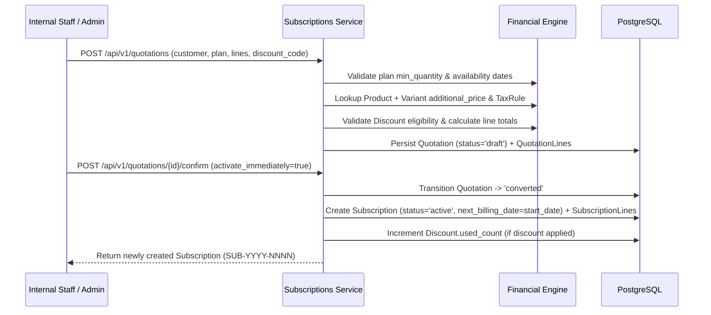

# End-to-End Business Workflows

This document details the core operational workflows implemented across the Subscription Management System.

---

## 1. User Registration, Login, Password Reset & Staff Provisioning

1. **Customer Self-Registration (`POST /api/v1/auth/register`)**:
   - Validates email uniqueness (case-insensitive) and password strength (minimum 8 characters, uppercase, lowercase, digit, and special character).
   - Hashes the password with salted PBKDF2-SHA256 (`backend/app/core/security.py`).
   - Atomically creates both a `User` (`role = 'customer'`) and a linked `Customer` profile inside a single database transaction, returning a signed JWT access token.
2. **Admin-Only Staff Creation (`POST /api/v1/auth/staff`)**:
   - Restricted strictly to users with `role = 'admin'`.
   - Creates `internal_staff` or `admin` accounts and writes an `AuditLog` entry (`CREATE_STAFF_USER`).
3. **Password Reset Flow**:
   - `POST /api/v1/auth/password-reset/request` generates a cryptographically random URL-safe reset token valid for 30 minutes.
   - `POST /api/v1/auth/password-reset/confirm` verifies token validity and expiry, updates `password_hash`, clears the token, and logs `PASSWORD_RESET_COMPLETE`.

---

## 2. Quotation-to-Subscription Conversion Workflow

---

## 3. Automated Billing-Day Detection & Idempotent Invoice Generation

When `POST /api/v1/invoices/billing/run` is invoked (either on a scheduled cron or manually from the Invoices console with a `target_date`):

1. **Job Initialization**: Creates a `BillingJob` record with `status = 'running'` and `target_date`.
2. **Row-Level Locking (`FOR UPDATE SKIP LOCKED`)**:
   - Queries all `Subscription` records where `status = 'active'` and `next_billing_date <= target_date`.
   - Locks eligible rows with `.with_for_update(skip_locked=True)` so concurrent billing workers never process the same subscription simultaneously.
3. **Missed-Period Catch-Up Loop**:
   - While `subscription.next_billing_date <= target_date`:
     - Computes `period_start = subscription.next_billing_date` and `period_end = advance_billing_date(period_start, plan.billing_period) - 1 day`.
     - **Idempotency Check**: Queries `Invoice` for `(subscription_id, period_start, period_end)`. If an invoice already exists, increments `duplicates_skipped`, advances `next_billing_date`, and continues without creating a duplicate.
     - **Snapshot Invoice Creation**: Copies each `SubscriptionLine` into an `InvoiceLine`, preserving historical unit price, discount amount, tax rate, and subtotal.
     - **Advance Schedule**: Advances `subscription.next_billing_date` to the start of the next period.
     - **Auto-Close Check**: If `subscription.expiry_date` is reached or `plan.auto_close_days` has elapsed, transitions `subscription.status = 'closed'` and clears `next_billing_date`.
4. **Overdue Sweep**: Marks any confirmed unpaid/partially-paid invoices whose `due_date < target_date` as `payment_status = 'overdue'` and transitions their linked active subscription to `past_due`.

---

## 4. Discount Eligibility & Validation Workflow

Discounts (`POST /api/v1/discounts`, `POST /api/v1/discounts/validate`) enforce 7 distinct business rules in `backend/app/core/financials.py` (`evaluate_discount_eligibility`):
1. **Active Flag**: `discount.is_active` must be `True`.
2. **Start Date**: `check_date >= discount.start_date`.
3. **Expiry Date**: `check_date <= discount.end_date`.
4. **Usage Limit**: `discount.used_count < discount.max_uses` (when `max_uses` is set).
5. **Minimum Purchase Subtotal**: Order subtotal must be `>= discount.min_purchase_amount`.
6. **Minimum Quantity**: Total line quantity must be `>= discount.min_quantity`.
7. **Product Scope**: If `discount.applies_to = 'product'`, the order must contain `discount.product_id`.

---

## 5. Payment Reconciliation & Partial Payment Workflow

1. **Pre-Validation**:
   - Verifies the target invoice is not `cancelled` or already `paid`.
   - If the invoice is still in `draft`, automatically confirms it before applying payment.
   - Checks `Payment.idempotency_key`: if a payment with the same key already exists, returns the existing payment immediately.
   - Rejects any payment where `amount > invoice.balance_due` with HTTP `400 Bad Request` (`Payment amount exceeds remaining invoice balance`).
2. **Allocation & State Transition**:
   - Adds `amount` to `invoice.amount_paid` and recalculates `invoice.balance_due = grand_total - amount_paid`.
   - If `balance_due == 0.00`:
     - Sets `invoice.state = 'paid'`, `invoice.payment_status = 'paid'`, and `invoice.paid_at = now()`.
     - If the parent subscription was `past_due` and has no other overdue invoices, automatically restores the subscription to `active`.
   - If `balance_due > 0.00`:
     - Sets `invoice.state = 'confirmed'` and `invoice.payment_status = 'partially_paid'` (or `'overdue'` if past due date).
3. **Audit Logging**: Records a `RECORD_PAYMENT` audit event with full monetary details.

