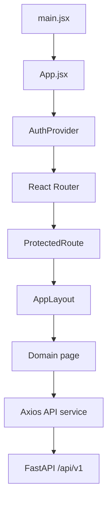

# Frontend Source

This directory contains the React application entrypoint, route definitions, UI components, pages, and API/authentication services.

## Entry points

- `main.jsx` mounts the React application into the root DOM element and loads global CSS.
- `App.jsx` configures the authentication provider, browser router, route guards, and page routes.

## Route map

| Route | Page | Access |
|---|---|---|
| `/login` | Authentication page | Public |
| `/dashboard` | Finance dashboard | Staff/admin |
| `/customers` | Customer management | Staff/admin |
| `/products` | Products and variants | Staff/admin |
| `/plans` | Subscription plans | Staff/admin |
| `/quotations` | Quotations | Staff/admin |
| `/subscriptions` | Subscription management | Staff/admin |
| `/invoices` | Invoice management | Staff/admin |
| `/discounts` | Discounts and tax rules | Staff/admin |
| `/payments` | Payment management | Staff/admin |
| `/portal` | Customer portal | Authenticated users; intended for customer role |

Unknown routes redirect to `/login`. The route guard redirects unauthenticated users to login and prevents customer accounts from entering staff-only pages.

## Source directories

- [components/](components/README.md) — layout, reusable UI, and table components.
- [pages/](pages/README.md) — route-level screens grouped by business domain.
- [services/](services/README.md) — API client, authentication context, and validators.

## Navigation and data flow

