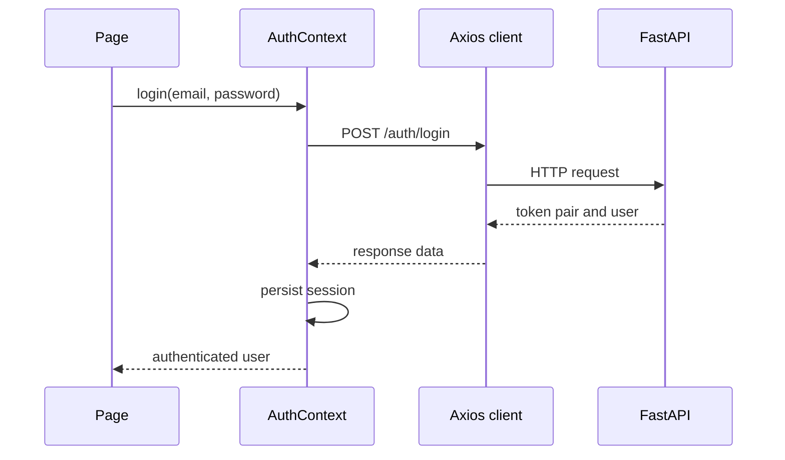

# Frontend Services

This directory contains the frontend's API integration, authentication/session state, and shared validation/formatting helpers.

## API client

[api/client.js](api/client.js) creates the Axios instance. Its base URL is `VITE_API_BASE_URL` or `/api/v1` by default. A request interceptor attaches the access token from browser local storage as a Bearer token.

The module exports grouped API functions for authentication, customers, products, plans, quotations, subscriptions, invoices, discounts, tax rules, payments, and reports. It also exports `extractErrorMessage` to normalize API errors for UI feedback.

## Authentication context

[auth/AuthContext.jsx](auth/AuthContext.jsx) exposes:

- `user` and `loading` session state.
- `login`, `register`, and `logout` actions.
- `isAdmin`, `isStaff`, and `isCustomer` role flags.

On application load, it checks for a stored access token and calls the current-user endpoint. Login and registration save the token pair and user profile; logout clears local session values even if the network request fails.

## Validators

The validators module provides shared form validation and formatting functions used by pages, including email/password checks and currency formatting.

## Request flow

## Security note

The current implementation stores access and refresh tokens in localStorage. This is convenient for the demo but increases exposure if the browser suffers an XSS compromise. Evaluate secure, HttpOnly cookie-based sessions or another hardened token strategy before production. Never put private API keys or server secrets in frontend environment variables.
